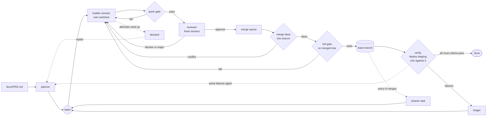

# Design

This harness builds a full-stack product from a PRD with as little human attention as it can,
and stops when the MVP is verified on staging or when only a person can move it forward.

It is a **graph executed by a loop**. The graph gives convergence: every task moves through
fixed states, every transition is decided by a command's exit code, and every retry is bounded.
The loop gives autonomy: one orchestrator process keeps ticking, starting fresh Claude Code
sessions for whatever the graph says is next.

## The three requirements, and how each is met

**1. Docs and harness files maintain themselves.**
Nothing is maintained by asking a session to remember to update it.

| File | Who writes it | How it stays true |
|---|---|---|
| `STATE.md` | orchestrator | rendered from `.harness/state.json` after every transition |
| `HANDOFF.md` | orchestrator | rendered from the same state: why it stopped, what to do next, per-task handoff notes |
| `CLAUDE.md` | cleaner agent | lessons reported by every session are folded in every few merges, through a gated and reviewed branch |
| `docs/ARCHITECTURE.md` | planner, cleaner | written before the first task, re-checked against merged code by the cleaner |
| `docs/decisions/*.md` | any builder, planner | one file per decision, named after the task, so parallel branches never collide |
| `docs/PRD.md` | you | the harness only reads it |
| `.claude/agents/*.md`, hooks, settings | you | protected from every session by a hook and by a post-session check |

On `HANDOFF.md`: a single hand-written handoff file does not fit a parallel loop. Several
sessions would edit it at once and it would be stale whenever a session died. So handoff is
structured output: every builder returns `handoff { done, remaining, gotchas, next_step }`,
the orchestrator stores it on the task, feeds it to the next session of that task, and renders
all of them into `HANDOFF.md` for a person.

**2. It loops until the MVP launches, with few stops for a human.**
"Launched" is defined by a command, not an opinion: every `must` criterion in the PRD has a
passing e2e test against the staging deployment. The loop stops for a person only when a task
has used all its attempts and a replan did not help, the same failure survived repeated fixes,
a session asked a question it marked blocking, or a budget ran out. Everything else, including
questions with a sensible default, is recorded and passed over.

**3. Agents, sessions, threads and worktrees are orchestrated dynamically.**
The orchestrator decides at every tick what runs, where, and in which session:
- one git worktree and branch per task, created on dispatch and removed on merge;
- one thread per task, which is a chain of sessions: feedback goes back to the session that
  wrote the code, and after a few rounds the thread rotates to a fresh session seeded with
  the handoff note;
- parallelism limited by declared file ownership, so tasks that would collide wait;
- a serialised merge queue, so the base branch only ever receives a tree that passed the full gate.

## The graph

Task states: `todo → building → built → gating → gated → reviewing → approved → premerge → merged`,
with `rework` (has feedback, keeps its worktree and thread), `blocked` and `cancelled` on the side.
Only the orchestrator moves a task between states.

## The loop

One process (`harness run`) owns `.harness/state.json`. Sessions never write state; they return
a JSON object (enforced with `--json-schema`) and the orchestrator applies it. That removes
races and merge conflicts on state by construction.

Each tick, in this order:

1. **Plan** if there is no plan yet, or a replan was requested.
2. **Advance** tasks: start the quick gate for anything built, a review for anything gated.
3. **Merge lane**: take the head of the queue, merge the base branch into it, run the full
   gate on the result, then land it. One at a time.
4. **Verify** when the queue drains or a milestone completes: deploy to staging, run e2e.
5. **Triage** failures into fix tasks.
6. **Schedule the cleaner** after enough merges.
7. **Dispatch builders** into free slots.

Then it waits for any child process to finish, applies the result, and ticks again. When a tick
starts nothing and nothing is running, the loop diagnoses why and stops with a reason.

Two lanes bound what runs at once: the *task lane* (`limits.concurrency` children: builders,
quick gates, reviews, each in a task worktree) and the *main lane* (one child: planner,
pre-merge gate, verification or triage).

## Roles

Five agent definitions are installed in `.claude/agents/`. The orchestrator starts each with
`claude -p --agent <role>` and a brief computed from state.

| Role | Runs in | May write | Returns |
|---|---|---|---|
| planner | main checkout | `docs/**`, `CLAUDE.md` | milestones, tasks with `depends_on`, `touches`, `acceptance`; `cancel`, `retry` on replan |
| builder | task worktree | product code, tests, `docs/decisions/` | status, summary, handoff, lessons, questions, discovered issues |
| reviewer | task worktree | nothing | verdict and findings with severity |
| triager | main checkout | nothing | fix tasks, each naming the issues it fixes |
| cleaner | task worktree | `CLAUDE.md`, `docs/**` | same as a builder |

Plans are validated by code before they are applied: unique keys, known criteria, no cycles,
and every unmet `must` criterion covered by a live task. An invalid plan goes back to the same
planner session with the list of problems, twice at most.

## Sessions and threads

- **Session ids are chosen before the session starts** (`--session-id`). If the orchestrator or
  the machine dies, the id is already in the state file and the thread can be resumed.
- **Feedback resumes** (`--resume`): gate failures, review findings and conflicts go back to the
  session that produced the work, up to `limits.maxResumesPerSession` times.
- **Rotation**: after that, or after any session failure, the thread gets a new session whose
  brief carries the task, the last failure, and the previous session's handoff.
- **Reviews, triage and planning always use a fresh session.** Independent eyes matter more than
  context there.
- **Inner loop**: a Stop hook reruns the quick gate when a builder tries to finish, and hands a
  failure straight back while the context is warm. It gives way after three rounds; the
  orchestrator's own gate is the authority.
- Cost is tracked per session id. A resumed conversation reports its whole cost, so only the
  difference is added.

Every in-flight thread is listed in `STATE.md` with its session id; `claude --resume <id>`
opens it.

## Worktrees

- Created with `git worktree add` under `../<repo>.worktrees/<task-id>` on branch
  `task/<task-id>`. They live outside the repository so tools and `CLAUDE.md` discovery never
  see two copies of the project.
- Each gets a slot, and from it a private port block and database path
  (`WEB_PORT`, `API_PORT`, `DATABASE_URL`), so parallel dev servers and e2e runs do not collide.
- Anything a session leaves uncommitted is committed by the orchestrator (`wip(T-012): …`).
  No work is lost between sessions, including on Ctrl+C.
- A task holds its declared paths (`touches`) until it merges. A task whose paths overlap one
  in flight waits. If two branches still conflict, the later one goes back to its builder with
  the conflicting files, and after resolving it lands without a second review (the full gate
  still runs).
- Removed on merge. A blocked or cancelled task keeps its branch.

## Convergence

A loop that only adds work never ends. These rules make it end:

| Rule | Effect |
|---|---|
| Gates are commands | "done" cannot be claimed, only demonstrated |
| Attempts per task are capped (`maxAttemptsPerTask`) | a task that keeps failing becomes `blocked` instead of spinning |
| One replan per exhausted task, `maxReplans` overall | the planner may retry with a new approach, split, or cancel, a bounded number of times |
| Only blocker and major review findings send work back | reviews cannot loop on taste; the rest is recorded for later |
| Only failing `must` criteria and failing verify steps block the launch by default | agent-reported P2/P3 problems go to the backlog; serious ones (P0/P1) get a fix task, at most `maxDiscoveredFixes` over the run |
| A session that returns `partial` is not resumed | the task continues in a fresh session seeded with its handoff |
| Fix tasks must name an open issue | triage cannot add scope |
| A criterion is only expected to pass once every task covering it has merged | no false alarms halfway through |
| Recurrence count per issue (`maxIssueRecurrence`) | a failure that survives its fixes becomes `stuck` and goes to a person |
| Stall detection (`stallCycles`) | the same failing set across verifications triggers a replan, then a stop |
| Session failures do not consume attempts | an expired login or rate limit stops the loop after three in a row instead of blocking every task |
| Budgets: sessions, dollars, hours, verify cycles | a hard ceiling on everything |

## Where a person is needed

By default, four places:

1. **Before**: write `docs/PRD.md` with acceptance criteria, and supply staging credentials in the environment.
2. **During, asynchronously**: `harness inbox` shows questions. Non-blocking ones were answered
   by the asking session's own default and are listed as assumptions you can overrule.
3. **When it stops with `needs_human`**: `HANDOFF.md` lists each item with the exact command
   (`harness answer`, `harness retry`, `harness cancel`, `harness reopen`, `harness dismiss`).
4. **After**: the production release. The loop ends at verified staging on purpose.

Set `humanGates.plan: true` to also approve the plan before any code is written.

## Safety

- Each role is confined by a PreToolUse hook: no edits to harness-owned or human-owned paths, no
  edits outside its own checkout, no pushing, rebasing or branch switching. Read-only roles
  cannot edit at all.
- A shell command can still write anywhere, so after every session the orchestrator compares
  the branch with the base and restores protected paths before review.
- The reviewer's brief includes deterministic signals from the diff: added skip, ignore or
  suppression markers, deleted test files, changed build or lint configuration.
- Skipped e2e tests never count as a passing criterion.
- Sessions run with `--permission-mode auto` by default (a classifier reviews each action).
  `acceptEdits` with the allow rules in `.claude/settings.json` is the stricter alternative;
  `bypassPermissions` belongs in a container or VM only.
- `.claude/settings.json` denies `git push`. Nothing leaves the machine except what your
  staging deploy script sends.

## Claude Code features this relies on

Checked against the Claude Code documentation in November 2026.

| Feature | Used for |
|---|---|
| `claude -p --output-format json` | headless sessions with cost and session id in the result |
| `--json-schema` | the structured result every role must return |
| `--agent <name>` with `.claude/agents/*.md` | role definitions |
| `--session-id`, `--resume`, `--name` | threads |
| `--permission-mode`, `--permission-prompts none` (2.1.259+, detected) | unattended runs |
| `--max-turns`, `--max-budget-usd` | per-session ceilings |
| hooks: `PreToolUse`, `Stop`, `SessionStart` | lane guard, inner gate loop, briefing interactive sessions |

Worktrees are created with plain git rather than `claude --worktree`, because the base ref must
be the local base branch and `-p` sessions do not clean up the worktrees Claude Code creates.
Agent teams, agent view and dynamic workflows are not used: they are experimental or
interactive, and the orchestration here has to be deterministic and restartable.

## Known limits

- Verified with a scripted stand-in for the `claude` binary (see `test/`): real git, real
  worktrees, real gate processes, real hook scripts, fake model. It has not yet been run end to
  end against real sessions. `harness doctor --live` closes the part of that gap that can be
  closed cheaply: two short real sessions that prove the flags, structured output, session ids,
  resume, permission mode, hooks and agent definitions behave as the loop assumes on the
  installed version. Prompts, turn limits and timeouts still need tuning on the first project.
- The Claude Code documentation says `--bare` will become the default for `-p` in a future
  release. This harness depends on `-p` sessions loading `CLAUDE.md`, agents and hooks from the
  project. When that default changes, `harness doctor --live` reports that the hooks did not
  run, and the session flags in `src/agents.mjs` need updating.
- State lives on one machine. It is not committed, so a second clone cannot continue a run.
- The main checkout must stay on the base branch with no local edits while the loop runs.
  Work in your own worktree if you want to code alongside it.
- macOS and Linux only (bash, process groups).
